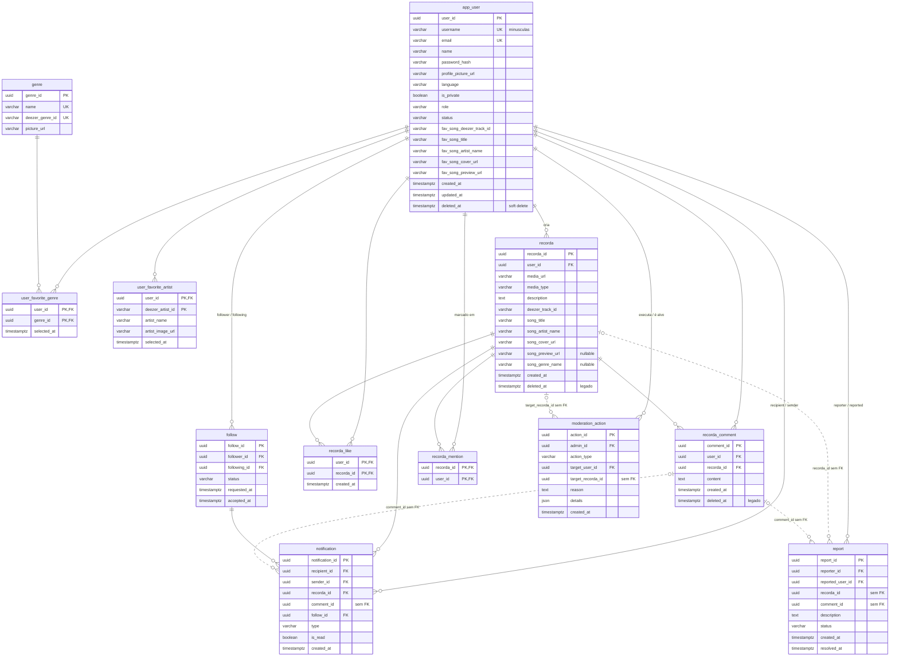

# Recorda — Modelo de Dados v3.0 (MVP)

**Status:** Decisões fechadas pelo sênior com adaptações técnicas consolidadas no backend (alinhado ao [ADR 0001](../adr/0001-alinhamento-ao-diagrama-do-banco.md) e ao [ADR 0002](../adr/0002-trilha-de-auditoria-de-moderacao.md)), atualizadas pelas regras aprovadas pelo **AGES IV** em nov/2026 (ver Parte 0). Este documento substitui a v2.0 e serve de referência canônica para os models SQLAlchemy, schemas Pydantic e migrations Alembic.

**Versão verificada.** `dev` @ **`86eb6bb`** (13/nov/2026), head Alembic **`0012_lowercase_usernames`**. Os fatos deste documento foram conferidos nas migrations, nos models, nos serviços e nos testes desse commit. Reconferido em 14/nov/2026: `dev` e `origin/dev` continuam em `86eb6bb`, sem migrations novas.

**Pendências deste documento.** Três pontos dependem de **decisão dos seniores** (S1–S3, Parte 0). Em cada um, o contrato descreve o que o backend faz hoje e separa o que ainda está em revisão; até a decisão, vale o comportamento implementado. Dois achados técnicos seguem em aberto (N1–N2, Parte 0), sem mudança no código desde a revisão. Os detalhes e os casos de teste ficam na wiki interna do time (`wiki/modelo-de-dados.md`, seção 11).

**Escopo.** Isto é um **MVP / POC**. O modelo cobre exatamente o que foi decidido — nada além. Tudo que não foi decidido está **fora do escopo** (ver Parte 7) e pode ser adicionado numa iteração futura sem quebrar o que existe: quase tudo seria coluna ou tabela nova, não migração destrutiva.

**Plataforma & Autenticação.** PostgreSQL (gerenciado via Docker/produção) com SQLAlchemy e Alembic, mantendo compatibilidade com SQLite para a suíte de testes unitários. A autenticação utiliza **JWT próprio + hash de senha via PBKDF2** (com desvio consciente em relação a provedores externos de auth, conforme documentado no ADR 0001).

> **Convenções (decisões técnicas fechadas)**
> - Nomes de tabela/coluna em `snake_case`. Os que colidiam com palavras reservadas viraram `app_user`, `recorda_like`, `recorda_comment` (D66).
> - Toda PK e FK é `UUID`. No backend, são geradas na aplicação (`uuid.uuid4()`) para compatibilidade com SQLite nos testes, e com `DEFAULT gen_random_uuid()` nas migrations PostgreSQL (D65).
> - **Referências históricas sem FK.** `report.recorda_id`, `report.comment_id`, `moderation_action.target_recorda_id` e `notification.comment_id` são UUIDs sem FK: guardam o identificador mesmo depois que o conteúdo é apagado.
> - Toda coluna temporal é `TIMESTAMPTZ` (D68). Todo recorte por dia, mês ou ano — streak, calendário, métricas e retrospectiva — é calculado no backend com fuso **fixo `America/Sao_Paulo`** (D41).
> - Enums são `VARCHAR` + `CHECK` (D67).
> - **Exclusão (AGES IV, qualifica D71).** Soft delete com `deleted_at` **só para usuários** (`app_user`). Recordas e comentários são excluídos **fisicamente**, pelo autor e pela moderação, junto com curtidas, marcações e notificações ligadas. `recorda.deleted_at` e `recorda_comment.deleted_at` permanecem apenas para ler e filtrar registros legados (excluídos antes da `0011`, que não os purgou). A trilha de auditoria `moderation_action` é append-only, sem `deleted_at`.
> - Provedor de música único: **Deezer**. Os dados da música ficam gravados (snapshot) no banco (D1, D9, D11). O backend não revalida a faixa na criação; a única consulta ao Deezer na criação é a busca opcional do gênero (Parte 1, princípio 1). A prévia de áudio é servida por uma rota da API que renova o link do Deezer sob demanda, porque o link gravado expira.
> - Migrações versionadas via **Alembic** (`alembic/`) (D69). Head: `0012_lowercase_usernames`.

---

## Parte 0 — O que mudou da v2.0 para a v3.0

**Tabelas removidas (5) — de 18 para 13**

| Tabela | Motivo |
|---|---|
| `ARTIST`, `SONG`, `SONG_ARTIST` | Substituídas por **snapshot** da música direto no `recorda` (D1). Sem catálogo local, sem importação/deduplicação. |
| `ARTIST_GENRE` | Explorar cruza gênero e artista como **sinais independentes**; não há vínculo artista→gênero (D2, D6). |
| `USER_FAVORITE_SONG` | Vira colunas `fav_song_*` em `app_user` (relação 1:1) (D15). |

**Renomeações físicas** (D66): `USER` → `app_user` · `LIKE` → `recorda_like` · `COMMENT` → `recorda_comment`.

**Colunas novas & Ajustes de Aplicação**

| Tabela | Coluna | Decisão / Motivo |
|---|---|---|
| `app_user` | `name` | Obrigatório no cadastro conforme requisito de produto (ADR 0001). |
| `app_user` | `password_hash` | Hash de senha PBKDF2 para autenticação via JWT próprio (ADR 0001). |
| `app_user` | `status` (`ACTIVE` / `SUSPENDED`) | D57 |
| `app_user` | `fav_song_deezer_track_id`, `fav_song_title`, `fav_song_artist_name`, `fav_song_cover_url`, `fav_song_preview_url` | D15 (anuláveis na criação, preenchidos no onboarding — ADR 0001). |
| `app_user` | índice `uq_app_user_username_lower` | Unicidade de `username` sem distinção de caixa. Migration `0012_lowercase_usernames`. |
| `recorda` | `deezer_track_id`, `song_title`, `song_artist_name`, `song_cover_url`, `song_preview_url` | D1, D5 (`song_cover_url` aceita `''` se a faixa não tiver capa — ADR 0001; `song_preview_url` é anulável). |
| `recorda` | `song_genre_name` (anulável) | Snapshot do gênero para o cálculo de preferências sem chamada síncrona ao Deezer. Migration `0010_recorda_song_genre_name` (#146). |
| `recorda_comment` | `deleted_at` | D52. Desde a `0011`, só para registros legados. |
| `notification` | `comment_id`, `follow_id` (opcionais) | D47. `follow_id` é FK; `comment_id` é UUID **sem FK**, por decisão do AGES IV. |
| `user_favorite_artist` | `deezer_artist_id`, `artist_name`, `artist_image_url` | D19 (snapshot; sem FK para tabela de artista). |

**Incremento da Sprint 3 — Épicos 09 e 10 (03 out 2026)**

Implementado nas issues **#79** (`report`) e **#83** (`moderation_action`), com as decisões registradas no [ADR 0002](../adr/0002-trilha-de-auditoria-de-moderacao.md).

- `report` é **materializada no schema físico**: a tabela já constava deste contrato, mas não tinha model nem migration. Migration `0007_report`. A constraint de alvo único passou a usar uma expressão portável, e a tabela ganhou dois índices únicos parciais e três índices de consulta.
- `moderation_action` é **nova**: o estado corrente da Parte 2 passa de 13 para **14 tabelas**. Migration `0008_moderation_action`. Append-only, imutável por trigger no PostgreSQL.
- **D55 supersedida.** **D71** e **D56** qualificadas. **D51 preservada.**

**Incremento do Épico 06 — Perfil e Configurações (18 out 2026)**

- **`genre` formalizada:** as colunas `deezer_genre_id` e `picture_url` (ADR 0001 e migration `0002_diagram_schema`) constam na tabela do modelo e no diagrama ER. Consumidas por `GET /users/me/music-preferences` e `GET /users/{user_id}/music-preferences` (issue **#110** / `T-E6.US31.BE.01`).
- **Simplificação arquitetural do Streak (US35):** implementado (issues **#113** / `T-E6.US35.BE.01` e **#123**). Streak exclusivo de publicações de Recordas, calculado sob demanda a partir de `recorda.created_at` em `America/Sao_Paulo`, **sem ledger separado nem tabela de cache**, exposto no `ProfileStreak` do contrato compartilhado **C-2** (`current_days`, `published_today`). A regra sobre Recordas excluídos foi revista pelo AGES IV (A1).
- **Decisões D42 e D43 supersedidas:** curtidas e comentários **não** contam para o streak. Apenas a criação de Recorda conta.
- **Tabelas do contrato ativo:** `user_streak` e `streak_activity`, que nunca foram materializadas, saem do contrato ativo, que passa de 14 para **12 tabelas**. A tabela técnica `media`, criada em `0001_baseline` para armazenar uploads, fica fora dessa contagem; o banco físico tem 13 tabelas.

**Incremento do Épico 07 — Memórias e métricas (nov 2026)**

- Migration **`0010_recorda_song_genre_name`** (#146): `recorda.song_genre_name` anulável, sem backfill na migration. Recordas anteriores ficam com `NULL` até o script `scripts/backfill_song_genres.py` ser executado no ambiente.
- Calendário (US37), métricas do perfil e retrospectiva (US39) são **calculados na leitura** sobre `recorda`, `recorda_like`, `recorda_comment` e `recorda_mention`; nada novo é persistido.

**Incremento de conteúdo, marcações e usernames (nov 2026)**

- Migration **`0011_content_deletion_mentions`**: remove as FKs de `report.recorda_id`, `report.comment_id` e `moderation_action.target_recorda_id` (referências históricas) e cria `recorda_mention` com o índice `ix_recorda_mention_user_id`. Não purga registros soft-deleted antes dela. O downgrade recusa restaurar as FKs se houver referência a conteúdo já apagado.
- Migration **`0012_lowercase_usernames`**: converte os usernames para minúsculas (em colisão, os seguintes recebem sufixo `_2`, `_3`…) e cria o índice único `uq_app_user_username_lower`.

**Regras aprovadas pelo AGES IV (nov 2026) — status em `86eb6bb`**

| # | Regra aprovada | Status |
|---|---|---|
| A1 | **Streak:** Recordas excluídos pelo autor ou removidos pela moderação ficam fora do cálculo, no perfil e nas métricas. Se o único Recorda de um dia for excluído, aquele dia deixa de contar. Supersede a preservação do "dia conquistado" e a decisão provisória sobre Recordas moderados. | ✅ Implementado. Perfil e métricas usam a mesma fonte. |
| A2 | **Exclusão:** soft delete só para usuários; Recordas e comentários são excluídos fisicamente, pelo autor e pela moderação. Qualifica D56 e D71. | ✅ Implementado. |
| A3 | **Curtidas:** as curtidas de um Recorda excluído ou removido são apagadas fisicamente. | ✅ Implementado. |
| A4 | **FKs de denúncias e auditoria:** tratadas para viabilizar A2. | ✅ Resolvido na `0011`: as FKs foram removidas e os UUIDs preservados; o trigger de imutabilidade foi mantido. |
| A5 | **Deezer:** a criação de um Recorda dispensa revalidação da faixa pelo backend; a seleção é do cliente; a busca de gênero é opcional e sua falha grava `NULL` sem impedir a publicação. Substitui a redação anterior da D10. | ✅ Implementado. |
| A6 | **`notification.comment_id`:** permanece UUID anulável **sem FK**. A decisão vale apenas para essa coluna. | ✅ Implementado. |
| A7 | **Comentários na retrospectiva:** a contagem segue os critérios da listagem e do calendário — exclui comentários apagados e comentários de contas excluídas ou suspensas. | ✅ Implementado. |

**Decisões técnicas resolvidas no código** (antes T1–T3)

- **T1 — FKs de denúncias e auditoria:** removidas na `0011`. O detalhe administrativo de um Recorda apagado devolve `{"recorda_id": "...", "removed": true}` e a listagem mostra "Conteúdo removido".
- **T2 — `deleted_at` de `recorda` e `recorda_comment`:** colunas mantidas para ler e filtrar registros legados; não são mais preenchidas.
- **T3 — Notificações:** as notificações do Recorda e de seus comentários são apagadas na mesma transação da exclusão; a exclusão de um comentário apaga as notificações com o seu `comment_id`.

**Comportamento atual e decisões pendentes dos seniores (S1–S3)**

Nos três pontos, o backend em `86eb6bb` já tem um comportamento definido, descrito nas tabelas da Parte 2. O que segue em revisão é se esse comportamento passa a ser regra aprovada do contrato.

| # | O que o backend faz hoje | Diverge do contrato anterior em | Segue em revisão |
|---|---|---|---|
| S1 — Marcações | Marcações só na criação (`POST /recordas`, `mentioned_user_ids`), até **20** por Recorda, ids repetidos deduplicados. Só se marca conta ativa, que não seja o autor, que o autor segue com follow `ACCEPTED` e que pode ver o Recorda — com autor privado, a pessoa também precisa ser seguidora aceita dele. Qualquer marcação inválida recusa a criação (422) sem gravar nada. Uma notificação `MENTION` por pessoa. Não há rota para se desmarcar. FK `recorda_mention.user_id → app_user` sem `ondelete`. | D20 (seguir **mutuamente**); D22 (máx. ~10); D23 (o marcado pode se desmarcar); `CASCADE` a partir de `app_user` na tabela 7. | Adotar o comportamento implementado como regra ou manter as decisões D20, D22 e D23 e o `CASCADE`, com ajuste no backend. |
| S2 — Denúncias | Quando o **autor** apaga um Recorda denunciado (`recorda_service.delete` → `delete_with_cleanup`), `report` não é alterado: as denúncias permanecem `OPEN`, com o UUID preservado, até o admin mudar o status. O admin vê "Conteúdo removido" e não consegue mais remover o Recorda (404, ou 409 se já houver `REMOVE_RECORDA`). | O contrato anterior não definia esse caso. | Manter o encerramento manual pelo admin ou encerrar as denúncias automaticamente quando o autor apaga o Recorda. |
| S3 — Legenda, preferências e `follow` | `PUT /recordas/{id}` permite ao autor alterar `description`. `user_favorite_genre.user_id` e `user_favorite_artist.user_id` são FKs sem `ondelete`. `follow` tem os índices de coluna única `ix_follow_follower_id` e `ix_follow_following_id`. | Princípio 4 ("criado, não se edita"); `CASCADE` a partir de `app_user` nas tabelas 4 e 5; índices compostos `(follower_id, status)` e `(following_id, status)` na Parte 5. | Adotar essas três diferenças como regra aprovada ou ajustar o backend ao contrato anterior. |

**Achados técnicos em aberto** (sem mudança no código até 14/nov/2026)

- **N1 — Acesso por link direto à mídia depois da exclusão do Recorda.** A exclusão física não apaga o arquivo em `media`. A regra de acesso (`app/services/media_service.py::ensure_published_media_visible`) serve a qualquer usuário autenticado um arquivo que não esteja ligado a nenhum Recorda, tratando-o como prévia de upload. *Cenário reproduzido:* com um Recorda de conta privada e um usuário autenticado que não segue essa conta, `GET /api/v1/recordas/media/{arquivo}` responde **404** enquanto o Recorda existe e **200** depois que o autor o apaga. O mesmo vale para a remoção pela moderação. *Resultado esperado:* depois da exclusão, quem não tinha acesso ao Recorda continua recebendo **404**. A forma de correção (apagar o arquivo, negar acesso a arquivo que já foi publicado ou outra) fica para o backend.
- **N2 — Credenciais iniciais de administradores versionadas.** `scripts/seed_admins.py` cria ou atualiza contas administrativas com senhas iniciais fixas no código, publicado em `origin/dev`. O script não é chamado pelo entrypoint nem pelo deploy; só roda se executado manualmente. *A verificar:* se o script foi executado em algum ambiente e se essas contas ainda usam as senhas iniciais; nesse caso, rotacioná-las e passar as senhas iniciais para fora do repositório (por exemplo, variáveis de ambiente). Ao ser executado, o script também reativa e restaura essas contas (`status = ACTIVE`, `deleted_at = NULL`) e redefine as senhas.

**Simplificações**

- `report.status` passa de 4 para **3** valores (`OPEN`, `RESOLVED`, `DISMISSED`) — sem `UNDER_REVIEW`.
- `report` **não** tem coluna de motivo estruturado; só `description` livre e opcional (D51).
- Sem papel `MODERATOR`, sem tabela `BLOCK` (D54, D37). A decisão D55 (sem `MODERATION_ACTION`) foi **supersedida** no incremento da Sprint 3 — ver a subseção acima e o [ADR 0002](../adr/0002-trilha-de-auditoria-de-moderacao.md).
- `recorda_mention` **não** tem status de aprovação (D24).
- Sem aviso de conteúdo removido: a US42 está como *Won't*, e a notificação `CONTENT_REMOVED` não é gerada.
- `user_streak` e `streak_activity` descontinuadas do contrato ativo do MVP; o streak é calculado sob demanda sobre `recorda`.

---

## Parte 1 — Princípios do MVP

1. **Snapshot-first.** A busca e a seleção de música/artista acontecem no cliente, contra o Deezer, no momento da escolha. O que interessa (`deezer_track_id`, título, artista principal, capa, preview) é **copiado** para o banco a partir do payload do cliente. Não há refresh: o dado é estático (D9). **D10 revista (AGES IV, A5):** a criação de um Recorda **não** revalida a faixa no backend; o backend aceita o snapshot enviado e faz apenas a busca **opcional** do gênero no Deezer, cuja falha grava `song_genre_name = NULL` e **não impede** a publicação.
2. **Privacidade vive no perfil, nunca no post.** `app_user.is_private` decide tudo. Não existe visibilidade por Recorda. Podem ver conteúdo: o próprio dono, qualquer usuário autenticado se a conta for pública, ou seguidor com `follow` `ACCEPTED` se for privada. Pedido `PENDING` não dá acesso. Marcação não concede acesso.
3. **Soft delete só para usuários (AGES IV, A2).** Excluir conta = preencher `app_user.deleted_at`. Excluir Recorda ou comentário = `DELETE` físico, junto com curtidas, marcações, comentários do Recorda e notificações ligadas. A remoção pela moderação segue a mesma regra (D56 qualificada), registrada em `moderation_action` na mesma transação. `moderation_action` é append-only — sem `deleted_at` e imutável por trigger. Denúncias e auditoria guardam o UUID do conteúdo apagado.
4. **Recorda é imutável, exceto a legenda.** Sem `updated_at` (D27). Mídia, música e marcações não mudam depois da criação; hoje o autor pode alterar `description` (ADR 0001). Comentário não é editável. *Adoção da edição de legenda como regra: em revisão (S3).*
5. **Regras "quantitativas" são da aplicação, não do banco.** Mínimos do onboarding (1 música, ≥3 gêneros, ≥3 artistas), máximos visuais (~5 gêneros, ~10 artistas), limite de marcações — tudo validado no app (D16, D17, D22). A API aceita até 50 gêneros e 50 artistas; o limite de marcações na API é 20 (*em revisão — S1*).
6. **Streak de publicações sem ledger separado (US35).** Conta dias consecutivos com pelo menos um Recorda publicado **e existente** (D42/D43 supersedidas), usando `recorda.created_at` no fuso fixo `America/Sao_Paulo` (D41), sem tabela de ledger (`streak_activity`) ou cache (`user_streak`). Conta-se o dia da publicação, não a data da memória; vários Recordas no mesmo dia contam como um dia. A sequência permanece válida se a última publicação foi hoje ou ontem; um dia inteiro sem publicação a interrompe, e a próxima publicação inicia uma nova sequência de 1 dia (T-E6.US35.BE.01). **AGES IV (A1):** Recordas excluídos pelo autor ou removidos pela moderação ficam fora do cálculo, no perfil e nas métricas; se o único Recorda de um dia for excluído, o dia deixa de contar.
7. **O que não está neste documento está fora do escopo do MVP** (Parte 7).

---

## Parte 2 — As 12 Tabelas do Contrato Ativo (e Modelagem de Domínio)

### 1. `app_user`

Conta + perfil + preferências 1:1 do onboarding. A tabela mais referenciada do modelo.

| Coluna | Tipo | Chave | Nulo | Descrição |
|---|---|---|---|---|
| user_id | UUID | PK | Não | gerado via `uuid.uuid4()` (compatível com SQLite e PostgreSQL) |
| username | VARCHAR | UNIQUE | Não | `@` público, gravado em minúsculas |
| email | VARCHAR | UNIQUE | Não | e-mail para autenticação JWT e contato |
| name | VARCHAR | — | Não | nome de exibição do usuário (ADR 0001) |
| password_hash | VARCHAR | — | Sim | hash da senha com PBKDF2 (autenticação JWT própria — ADR 0001) |
| profile_picture_url | VARCHAR | — | Sim | foto de perfil |
| language | VARCHAR | — | Não | ex.: `pt-BR` (default `pt-BR`) |
| is_private | BOOLEAN | — | Não | default `false`; `true` = follow precisa de aprovação |
| role | VARCHAR | — | Não | `CHECK IN ('USER','ADMIN')`, default `USER` |
| status | VARCHAR | — | Não | `CHECK IN ('ACTIVE','SUSPENDED')`, default `ACTIVE` |
| fav_song_deezer_track_id | VARCHAR | — | Sim | música preferida — snapshot (preenchido no onboarding) |
| fav_song_title | VARCHAR | — | Sim | " |
| fav_song_artist_name | VARCHAR | — | Sim | artista principal |
| fav_song_cover_url | VARCHAR | — | Sim | capa (aceita `''` quando ausente — ADR 0001) |
| fav_song_preview_url | VARCHAR | — | Sim | prévia de áudio, quando o Deezer fornece |
| created_at | TIMESTAMPTZ | — | Não | criação da conta |
| updated_at | TIMESTAMPTZ | — | Não | última alteração do perfil |
| deleted_at | TIMESTAMPTZ | — | Sim | soft delete: nulo = conta ativa |

**Chaves & constraints.** PK `user_id`. `UNIQUE (username)`, `UNIQUE (email)`. Índice único `uq_app_user_username_lower` em `lower(username)` (`0012`).

**Regras (MVP)**
- O usuário é registrado com `username`, `email`, `name` e senha (`password_hash`). Os campos `fav_song_*` são anuláveis na criação e preenchidos no onboarding obrigatório (D13, D16). O indicador `onboarding_completed` é derivado na aplicação (`fav_song_deezer_track_id IS NOT NULL`). Trocar a música preferida é `UPDATE` direto nessas colunas, sem histórico (D14).
- `username` é convertido para minúsculas no cadastro e no login; a unicidade e as buscas por username não distinguem caixa.
- `role = 'ADMIN'` é atribuído via banco ou pelo script `scripts/seed_admins.py` (D53; ver N2).
- `status = 'SUSPENDED'` bloqueia o login e geração de tokens JWT. A moderação seta esse valor (D56, D57). Conta suspensa ou excluída é tratada como inexistente nas leituras de terceiros.
- Sem `bio`. Sem colunas de anonimização/LGPD (D58, D59).

**Deleção.** Soft delete — único caso de soft delete do modelo (AGES IV). O backend filtra `deleted_at IS NULL` em login, busca, feed, listas de seguidores e sugestões (D34). Recordas, comentários e marcações da conta ficam gravados, ocultos pelos filtros de autor ativo.

---

### 2. `follow`

Uma linha por relação direcionada "A segue B".

| Coluna | Tipo | Chave | Nulo | Descrição |
|---|---|---|---|---|
| follow_id | UUID | PK | Não | |
| follower_id | UUID | FK → app_user | Não | quem segue |
| following_id | UUID | FK → app_user | Não | quem é seguido |
| status | VARCHAR | — | Não | `CHECK IN ('PENDING','ACCEPTED')` |
| requested_at | TIMESTAMPTZ | — | Não | quando foi solicitado |
| accepted_at | TIMESTAMPTZ | — | Sim | quando foi aceito (nulo enquanto pendente) |

**Chaves & constraints.** PK `follow_id`. `UNIQUE (follower_id, following_id)`. `CHECK (follower_id <> following_id)`.

**Regras (MVP)**
- Perfil público → a linha nasce `ACCEPTED`. Privado → nasce `PENDING`; só `ACCEPTED` dá acesso aos Recordas.
- Privado → público: `UPDATE` em lote `PENDING → ACCEPTED` (preenchendo `accepted_at`), em uma transação (D35).
- Público → privado: quem já seguia permanece `ACCEPTED`; só novos pedidos entram como `PENDING` (D36).

**Deleção.** `ON DELETE CASCADE` a partir de `app_user`. Como contas são soft-deleted, na prática as linhas ficam e o backend as filtra pelas contas ativas.

---

### 3. `genre`

Vocabulário controlado de gêneros, definido pelo próprio sistema.

| Coluna | Tipo | Chave | Nulo | Descrição |
|---|---|---|---|---|
| genre_id | UUID | PK | Não | |
| name | VARCHAR | UNIQUE | Não | ex.: `Rock`, `MPB` |
| deezer_genre_id | VARCHAR | UNIQUE | Sim | id do gênero no Deezer (ADR 0001, US31) |
| picture_url | VARCHAR | — | Sim | imagem ilustrativa da categoria do Deezer |

**Regras (MVP)**
- Seed inicial de 18 gêneros (Parte 6). Ao salvar as preferências, cada gênero do Deezer é casado com uma linha de `genre` primeiro por `deezer_genre_id` e depois por `name`; sem correspondência, o backend cria a linha (ADR 0001).
- Na leitura das preferências, gêneros sem `deezer_genre_id` são omitidos.
- Sem vínculo com artista (`ARTIST_GENRE` não existe). Gênero só se conecta ao usuário via `user_favorite_genre` (D2, D6). Não classifica Recordas: o gênero do Recorda é o snapshot `recorda.song_genre_name`.

**Deleção.** Não se apaga gênero — é referenciado por preferências de muitos usuários.

---

### 4. `user_favorite_genre`

Gêneros favoritos escolhidos no onboarding (editáveis depois).

| Coluna | Tipo | Chave | Nulo | Descrição |
|---|---|---|---|---|
| user_id | UUID | PK, FK → app_user | Não | |
| genre_id | UUID | PK, FK → genre | Não | |
| selected_at | TIMESTAMPTZ | — | Não | |

**Chaves & constraints.** PK composta `(user_id, genre_id)` — impede duplicado.

**Regras (MVP).** Mínimo 3 no onboarding; máximo visual ~5 (D16, D17). A D16 previa mínimo 1; os requisitos funcionais (US3, US31) e a validação do backend (`MINIMUM_SELECTION = 3`) adotam 3. Edição por `INSERT`/`DELETE` (D18): salvar as preferências substitui a seleção inteira. A FK `user_id → app_user` não tem `ondelete`; o contrato anterior previa `CASCADE`, sem efeito prático enquanto contas forem soft-deleted (*em revisão — S3*).

---

### 5. `user_favorite_artist`

Artistas favoritos do onboarding, guardados como **snapshot do Deezer** — sem tabela global de artista (D19).

| Coluna | Tipo | Chave | Nulo | Descrição |
|---|---|---|---|---|
| user_id | UUID | PK, FK → app_user | Não | |
| deezer_artist_id | VARCHAR | PK | Não | id do artista no Deezer |
| artist_name | VARCHAR | — | Não | snapshot |
| artist_image_url | VARCHAR | — | Sim | snapshot |
| selected_at | TIMESTAMPTZ | — | Não | |

**Chaves & constraints.** PK composta `(user_id, deezer_artist_id)`.

**Regras (MVP)**
- "Artistas em comum" no Explorar = mesmo `deezer_artist_id` entre usuários (D74).
- Mínimo 3 no onboarding; máximo visual ~10 (D16, D17). Edição por `INSERT`/`DELETE` (D18), com substituição da seleção inteira. A FK `user_id → app_user` não tem `ondelete`; o contrato anterior previa `CASCADE` (*em revisão — S3*).

---

### 6. `recorda`

A entidade central: uma memória musical. Amarra um usuário, uma mídia e o **snapshot** de uma música do Deezer.

| Coluna | Tipo | Chave | Nulo | Descrição |
|---|---|---|---|---|
| recorda_id | UUID | PK | Não | |
| user_id | UUID | FK → app_user | Não | autor |
| media_url | VARCHAR | — | Não | caminho/URL do arquivo de mídia (armazenamento local / bucket) (D31) |
| media_type | VARCHAR | — | Não | `CHECK IN ('PHOTO','VIDEO')` |
| description | TEXT | — | Sim | legenda opcional |
| deezer_track_id | VARCHAR | — | Não | id da faixa no Deezer |
| song_title | VARCHAR | — | Não | snapshot |
| song_artist_name | VARCHAR | — | Não | artista principal (D8) |
| song_cover_url | VARCHAR | — | Não | capa (D5; aceita `''` se não houver — ADR 0001) |
| song_preview_url | VARCHAR | — | **Sim** | prévia de áudio, quando o Deezer fornece; `NULL` se a faixa não tiver prévia |
| song_genre_name | VARCHAR | — | **Sim** | gênero principal do álbum da faixa no Deezer, capturado na criação; `NULL` em Recordas anteriores à `0010` ainda não preenchidos ou se o Deezer não informar ou falhar (#146) |
| created_at | TIMESTAMPTZ | — | Não | data de publicação; ordena o feed, filtra por data e alimenta streak, calendário, métricas e retrospectiva |
| deleted_at | TIMESTAMPTZ | — | Sim | apenas registros legados (soft-deleted antes da `0011`); exclusões novas são físicas |

**Chaves & constraints.** PK `recorda_id`. FK `user_id → app_user(user_id)`.

**Regras (MVP)**
- **Imutável, exceto a legenda:** sem `updated_at` (D27). `PUT /recordas/{id}` permite ao autor alterar só `description` (ADR 0001); os demais campos não mudam. *Adoção como regra: em revisão (S3).*
- Exatamente 1 mídia (`media_url` + `media_type` obrigatórios) (D28).
- `deezer_track_id`, `song_title`, `song_artist_name` e `song_cover_url` são `NOT NULL` (a capa aceita `''`); `song_preview_url` e `song_genre_name` são anuláveis. Snapshot estático (D9). O backend não revalida a faixa (D10 revista — A5).
- `song_genre_name` é preenchido na criação: se o cliente enviar um valor não vazio, ele é gravado como veio; senão, o backend busca o gênero do álbum da faixa no Deezer e, se o álbum trouxer só o `genre_id`, consulta `/genre/{id}`. Qualquer falha grava `NULL` sem impedir a publicação. O valor é o nome do gênero no Deezer, sem FK para `genre`. O script `scripts/backfill_song_genres.py` preenche depois os Recordas existentes com gênero nulo ou vazio, sem sobrescrever valores.
- Visibilidade derivada de `app_user.is_private`, nunca armazenada aqui.
- Filtro de perfil por artista = `song_artist_name ILIKE '%texto%'` (D3). Por música = `deezer_track_id`. Por data = `created_at`.

**Deleção (AGES IV, A2/A3).** Excluir pelo autor ou remover pela moderação = `DELETE` físico, em uma transação, das notificações do Recorda e de seus comentários, das curtidas, dos comentários e do Recorda; as marcações saem por `CASCADE`. Na moderação, o registro em `moderation_action` vai no mesmo commit (D56 qualificada). Denúncias e auditoria mantêm o UUID. Recordas excluídos ou removidos deixam de contar no streak (A1). O arquivo em `media` não é apagado (ver N1).

---

### 7. `recorda_mention`

Marcação de amigos em um Recorda. Migration `0011_content_deletion_mentions`.

| Coluna | Tipo | Chave | Nulo | Descrição |
|---|---|---|---|---|
| recorda_id | UUID | PK, FK → recorda (`ON DELETE CASCADE`) | Não | |
| user_id | UUID | PK, FK → app_user | Não | amigo marcado |

**Chaves & constraints.** PK composta `(recorda_id, user_id)` — o mesmo amigo não é marcado duas vezes. Índice `ix_recorda_mention_user_id`.

**Regras (MVP)**
- **Sem aprovação** (sem status `PENDING`/`ACCEPTED`): a marcação é direta na criação do Recorda (`POST /recordas`, `mentioned_user_ids`, ids repetidos deduplicados) e gera uma `notification` do tipo `MENTION` por pessoa (D24, D25).
- Se alguma marcação for inválida, a criação é recusada (422) e nada é gravado.
- Marcação não concede acesso: só se marca quem já pode ver o Recorda.
- Marcação de conta excluída ou suspensa some das leituras pelo filtro de conta ativa (D26).
- Leitura: detalhe do Recorda e feeds (`mentioned_users`) e retrospectiva (até 5 mais marcados).
- **Quem pode ser marcado (hoje):** conta ativa, que não seja o autor, que o autor segue com follow `ACCEPTED` e que pode ver o Recorda; com autor privado, a pessoa também precisa ser seguidora aceita dele. Até 20 por Recorda. Não há rota para se desmarcar.
- *Divergência com o contrato anterior — em revisão (S1):* D20 previa follow **mútuo**, D22 previa máx. ~10 e D23 previa que o marcado pudesse se desmarcar apagando a própria linha.

**Deleção.** `CASCADE` a partir de `recorda`. A FK `user_id → app_user` não tem `ondelete`; o contrato anterior previa `CASCADE` (*em revisão — S1*), sem efeito prático enquanto contas forem soft-deleted.

---

### 8. `recorda_like`

Uma linha por "usuário curtiu Recorda".

| Coluna | Tipo | Chave | Nulo | Descrição |
|---|---|---|---|---|
| user_id | UUID | PK, FK → app_user | Não | quem curtiu |
| recorda_id | UUID | PK, FK → recorda | Não | |
| created_at | TIMESTAMPTZ | — | Não | momento da curtida |

**Chaves & constraints.** PK composta `(user_id, recorda_id)` — curtida duplicada é estruturalmente impossível.

**Regras (MVP)**
- Contagem por `COUNT(*)`, sem coluna desnormalizada (D33).
- **Streak (Épico 06 / US35):** as decisões D42 e D43 foram supersedidas. O streak é exclusivo de publicações de Recordas; curtir ou descurtir **não** pontua nem altera o streak.

**Deleção.** `DELETE` físico ao descurtir e quando o Recorda é excluído ou removido (A3). `CASCADE` a partir dos dois pais.

---

### 9. `recorda_comment`

Comentário de texto em um Recorda.

| Coluna | Tipo | Chave | Nulo | Descrição |
|---|---|---|---|---|
| comment_id | UUID | PK | Não | |
| user_id | UUID | FK → app_user | Não | autor |
| recorda_id | UUID | FK → recorda | Não | |
| content | TEXT | — | Não | texto do comentário |
| created_at | TIMESTAMPTZ | — | Não | |
| deleted_at | TIMESTAMPTZ | — | Sim | D52; apenas registros legados (soft-deleted antes da `0011`) |

**Chaves & constraints.** PK `comment_id`. FKs para `app_user` e `recorda` (`CASCADE` a partir de `recorda`).

**Regras (MVP)**
- Não editável (sem `updated_at`). Comentar não pontua streak (D42 supersedida no Épico 06 / US35).
- Podem excluir o comentário o seu autor e o autor do Recorda. A moderação não remove comentário isoladamente; os comentários saem junto com o Recorda removido.
- **Contagem e visibilidade (AGES IV, A7):** listagem, calendário e retrospectiva consideram só comentários existentes de autores ativos.
- Contagem por `COUNT(*)` (D33).

**Deleção (AGES IV, A2).** `DELETE` físico, junto com as notificações que apontam para o comentário. Uma denúncia com o `comment_id` mantém o UUID. A partir de `app_user`, como contas continuam soft-deleted, o comentário sobrevive atribuído à conta inativa e é escondido pelos filtros de autor ativo.

---

### 10. `user_streak` *(Descontinuada no Épico 06 — ver US35 e issue #113)*

> **Status:** descontinuada no contrato do MVP; o streak é calculado sob demanda sobre a tabela `recorda` (T-E6.US35.BE.01). Nunca foi materializada. Mantida nesta seção apenas como registro histórico do modelo v3.0 conceitual inicial.

Placar de streak — cache derivado 1:1 com `app_user`. No modelo v3 original, previa:

| Coluna | Tipo | Chave | Nulo | Descrição |
|---|---|---|---|---|
| user_id | UUID | PK, FK → app_user | Não | |
| current_streak | INT | — | Não | default 0 |
| longest_streak | INT | — | Não | default 0 |
| last_active_date | DATE | — | Sim | dia ativo mais recente (nulo = nunca ativo) |

**Regras (Supersedidas no Épico 06).** O streak é calculado sob demanda a partir de `recorda.created_at`, sem ledger separado nem tabela de cache. Equivalentes calculados: `current_days` e `published_today` (perfil), `current_streak_days` e `last_post_date` (métricas) e `max_streak` (retrospectiva, restrito ao período). Todos consideram só Recordas existentes (A1).

---

### 11. `streak_activity` *(Descontinuada no Épico 06 — ver US35 e issue #113)*

> **Status:** supersedida pela eliminação de ledger separado (T-E6.US35.BE.01). Nunca foi materializada. Mantida nesta seção apenas como registro histórico do modelo v3.0 conceitual inicial.

No modelo original, previa um ledger diário de atividades:

| Coluna | Tipo | Chave | Nulo | Descrição |
|---|---|---|---|---|
| user_id | UUID | PK, FK → app_user | Não | |
| activity_date | DATE | PK | Não | dia de calendário em **`America/Sao_Paulo`** (D41) |

**Regras (Supersedidas no Épico 06).**
- As decisões **D42** (curtir/comentar alimentam streak) e **D43** foram supersedidas: apenas a publicação de Recordas é contabilizada.
- No Épico 06, a justificativa para dispensar o ledger foi que a exclusão lógica de `recorda` preservaria o dia conquistado mesmo após a exclusão.
- **AGES IV (A1):** a preservação do dia conquistado foi abandonada — Recordas excluídos ou removidos saem do streak. O descarte de `streak_activity` continua válido, porque nenhum histórico de dias precisa ser preservado.

---

### 12. `notification`

Aviso dentro do app para um evento social.

| Coluna | Tipo | Chave | Nulo | Descrição |
|---|---|---|---|---|
| notification_id | UUID | PK | Não | |
| recipient_id | UUID | FK → app_user | Não | quem recebe |
| sender_id | UUID | FK → app_user | Sim | quem causou (nulo p/ avisos do sistema) |
| recorda_id | UUID | FK → recorda | Sim | Recorda relacionado, quando aplicável |
| comment_id | UUID | — (sem FK) | Sim | deep-link para o comentário (D47); **sem FK**, por decisão do AGES IV (A6) |
| follow_id | UUID | FK → follow | Sim | deep-link para o pedido de follow (D47) |
| type | VARCHAR | — | Não | `CHECK IN ('FOLLOW_REQUEST','FOLLOW_ACCEPTED','NEW_FOLLOWER','LIKE','COMMENT','MENTION','CONTENT_REMOVED')` |
| is_read | BOOLEAN | — | Não | default `false` |
| created_at | TIMESTAMPTZ | — | Não | |

**Chaves & constraints.** PK `notification_id`. `ck_notification_no_self_notification` — `CHECK (recipient_id <> sender_id)`. `CONTENT_REMOVED` entrou no `CHECK` de `type` na migration `0009_notification_content_removed`.

**Regras (MVP)**
- **1 linha por evento**, sem agrupamento estrutural — o agrupamento ("5 pessoas curtiram") é só apresentação (D49).
- Sem tipo "novo Recorda de quem sigo" (D40).
- Tipos gerados pelo app: `FOLLOW_REQUEST`, `FOLLOW_ACCEPTED`, `NEW_FOLLOWER`, `LIKE`, `COMMENT` (estes dois não são gerados quando o autor age no próprio Recorda) e `MENTION`.
- **`CONTENT_REMOVED` não é gerada.** O tipo está no `CHECK` e a função de envio existe, mas a remoção pela moderação não a chama: a US42 (aviso de conteúdo removido) está como *Won't*.
- `comment_id` sem FK (A6): a decisão vale **apenas** para essa coluna; as demais referências da tabela continuam com FK.
- As notificações de um Recorda e de seus comentários são apagadas quando o conteúdo é apagado (T3). As leituras escondem notificações cujo `sender` ou autor do Recorda esteja inativo.

**Deleção.** `CASCADE` a partir de `recipient_id`. `SET NULL` em `sender_id`, `recorda_id` e `follow_id` quando o alvo for removido fisicamente. Na exclusão de conteúdo, o backend apaga as notificações ligadas antes de apagar o conteúdo.

---

### 13. `report`

Caso de moderação aberto por um usuário contra **exatamente um** alvo: outro usuário, um Recorda ou um comentário.

| Coluna | Tipo | Chave | Nulo | Descrição |
|---|---|---|---|---|
| report_id | UUID | PK | Não | |
| reporter_id | UUID | FK → app_user | Não | quem denunciou |
| reported_user_id | UUID | FK → app_user | Sim | alvo usuário |
| recorda_id | UUID | — (sem FK desde `0011`) | Sim | alvo Recorda; preservado após a exclusão |
| comment_id | UUID | — (sem FK desde `0011`) | Sim | alvo comentário; coluna reservada |
| description | TEXT | — | Sim | texto livre **opcional** (D51) |
| status | VARCHAR | — | Não | `CHECK IN ('OPEN','RESOLVED','DISMISSED')`, default `OPEN` |
| created_at | TIMESTAMPTZ | — | Não | |
| resolved_at | TIMESTAMPTZ | — | Sim | quando foi encerrada |

**Chaves & constraints.** PK `report_id`.

- `ck_report_single_target` — exatamente um alvo. Escrita como soma de `CASE WHEN <alvo> IS NOT NULL THEN 1 ELSE 0 END = 1` sobre as três colunas de alvo, e não com `num_nonnulls()`: essa função é exclusiva do PostgreSQL e não existe no SQLite usado pela suíte de testes.
- `uq_report_reporter_recorda` — índice **único parcial** em `(reporter_id, recorda_id)` com `WHERE recorda_id IS NOT NULL`.
- `uq_report_reporter_user` — índice **único parcial** em `(reporter_id, reported_user_id)` com `WHERE reported_user_id IS NOT NULL`.

Os dois índices únicos impedem que o mesmo denunciante denuncie o mesmo alvo duas vezes, sem impedir denúncias de alvos diferentes — a cláusula `WHERE` evita a colisão entre as linhas cujo alvo é nulo.

**Regras (MVP)**
- **Sem motivo estruturado** (sem coluna `reason`, sem ENUM). Só `description` opcional (D51). O `reason` de `moderation_action` é outro conceito: é o motivo da **decisão do moderador**, não o motivo alegado pelo denunciante — D51 segue valendo aqui.
- `description` aceita no máximo **500 caracteres**, validado na aplicação (D-04); sem restrição de tamanho no banco.
- O admin resolve removendo o Recorda ou setando `status = 'SUSPENDED'` no `app_user`; a remoção marca as denúncias abertas do Recorda como `RESOLVED`. A ação é registrada em `moderation_action` **na mesma transação** (D55 supersedida — ADR 0002).
- Alvo apagado: o detalhe administrativo devolve `{"recorda_id": "...", "removed": true}` e a listagem mostra "Conteúdo removido".
- **Recorda apagado pelo autor:** as denúncias permanecem `OPEN` até o admin mudar o status manualmente. *Manter esse fluxo ou encerrar automaticamente: em revisão (S2).*
- `comment_id` é coluna reservada: não há rota de denúncia de comentário no MVP.

**Deleção.** Uma denúncia nunca é apagada. `reporter_id` e `reported_user_id` são FKs sem `ondelete`; `recorda_id` e `comment_id` não têm FK (A4) e mantêm o UUID do conteúdo apagado.

---

### 14. `moderation_action`

Trilha de auditoria das ações administrativas de moderação: quem agiu, qual ação, sobre qual alvo, quando e por qual motivo. **Append-only e imutável** (ADR 0002).

| Coluna | Tipo | Chave | Nulo | Descrição |
|---|---|---|---|---|
| action_id | UUID | PK | Não | |
| admin_id | UUID | FK → app_user | Não | quem executou a ação |
| action_type | VARCHAR | — | Não | `CHECK IN ('REMOVE_RECORDA','CHANGE_REPORT_STATUS','SUSPEND_USER','REACTIVATE_USER')` |
| target_user_id | UUID | FK → app_user | Sim | alvo usuário |
| target_recorda_id | UUID | — (sem FK desde `0011`) | Sim | alvo Recorda; preservado após a remoção |
| reason | TEXT | — | Não | motivo **obrigatório** da decisão (D-02) |
| details | JSON | — | Sim | contexto livre, ex.: `{"resolved_reports": 2}` |
| created_at | TIMESTAMPTZ | — | Não | quando a ação ocorreu |

**Chaves & constraints.** PK `action_id`. FKs `admin_id` e `target_user_id` → `app_user(user_id)`, sem `ondelete`.

- `ck_moderation_action_type` — vocabulário fechado dos quatro `action_type` (D67).
- `ck_moderation_action_has_target` — `target_user_id IS NOT NULL OR target_recorda_id IS NOT NULL`: **pelo menos um** alvo, diferente de `ck_report_single_target`, que exige exatamente um.

**Regras (MVP)**
- **Append-only.** Nunca sofre `UPDATE` nem `DELETE`. Sem `updated_at`, sem `deleted_at` (D71 qualificada).
- **Imutabilidade imposta no banco.** A migration `0008_moderation_action` cria a função `moderation_action_immutable()` e o trigger `trg_moderation_action_immutable` (`BEFORE UPDATE OR DELETE ... FOR EACH ROW`), que levanta a exceção `moderation_action é imutável`. O trigger é **específico do PostgreSQL**; o SQLite da suíte de testes não tem equivalente. Sem FK em `target_recorda_id`, a exclusão física do Recorda não toca a trilha.
- `reason` é obrigatório e aceita no máximo **500 caracteres**, validado na aplicação (D-04); sem restrição de tamanho no banco. O backend normaliza com `strip()` antes de validar e de persistir.
- `details` é JSON livre, sem schema por `action_type` e sem validação de estrutura.
- `REMOVE_RECORDA` preenche **os dois** alvos: `target_recorda_id` com a Recorda e `target_user_id` com o autor dela. Uma segunda remoção do mesmo Recorda responde 409.
- Não há alvo de comentário: `report.comment_id` existe como coluna reservada, mas não há rota de denúncia de comentário no MVP.
- **Atomicidade.** A mudança de estado administrativa e o registro da auditoria são persistidos no mesmo commit.

**Deleção.** Nunca. O trigger recusa `DELETE` de linhas da própria trilha.

---

## Parte 3 — Relacionamentos

| A | Relacionamento | B | Cardinalidade | Junção |
|---|---|---|---|---|
| app_user | segue | app_user | N : M | `follow` |
| app_user | cria | recorda | 1 : N | — |
| app_user | música preferida (colunas `fav_song_*`) | — | 1 : 1 | — |
| app_user | gêneros favoritos | genre | N : M | `user_favorite_genre` |
| app_user | artistas favoritos (snapshot) | — | 1 : N | `user_favorite_artist` |
| app_user | curte | recorda | N : M | `recorda_like` |
| app_user | comenta | recorda | 1 : N | `recorda_comment` |
| app_user | marcado em | recorda | N : M | `recorda_mention` |
| app_user | streak de publicações | recorda | 1 : N | calculado sob demanda sobre `created_at`, só Recordas existentes (US35, A1) |
| app_user | recebe / dispara | notification | 1 : N | — |
| app_user | abre / é alvo | report | 1 : N | FKs `reporter_id`, `reported_user_id` |
| recorda | é alvo de | report | 1 : N | `recorda_id`, referência histórica sem FK |
| recorda_comment | é alvo de | report | 1 : N | `comment_id`, referência histórica sem FK |
| recorda / follow | deep-link de | notification | 1 : N | FK |
| recorda_comment | deep-link de | notification | 1 : N | `comment_id`, referência sem FK (A6) |
| app_user | executa | moderation_action | 1 : N | FK `admin_id` |
| app_user | é alvo de | moderation_action | 1 : N | FK `target_user_id` |
| recorda | é alvo de | moderation_action | 1 : N | `target_recorda_id`, referência histórica sem FK |

---

## Parte 4 — Diagrama ER

> Linhas tracejadas = referência por UUID **sem FK**. `deleted_at` em `recorda` e `recorda_comment` existe só para registros legados. A tabela técnica `media` fica fora do contrato (ADR 0001).

---

## Parte 5 — Índices (D70)

Enxutos — nas FKs e nos campos de ordenação/busca:

- `recorda (user_id, created_at DESC)` — linha do tempo do perfil, feed, streak de publicações, calendário, métricas e retrospectiva
- `recorda (deezer_track_id)` — filtro "meus Recordas com essa música"
- `recorda` — índice **GIN `pg_trgm`** em `song_artist_name` e em `song_title` — filtro por artista (`ILIKE`) e busca de conteúdo (D3, D75) *(definidos nas migrações Alembic)*
- `follow` — `ix_follow_follower_id` (`0003`) e `ix_follow_following_id` (`0004`), de coluna única: feed e listas de seguidores. O contrato anterior previa `(follower_id, status)` e `(following_id, status)` *(em revisão — S3)*
- `recorda_like (recorda_id)` e `recorda_comment (recorda_id)` — contagens e listagens
- `recorda_mention (user_id)` — `ix_recorda_mention_user_id`, Recordas em que a pessoa foi marcada (a PK cobre `(recorda_id, user_id)`, não essa direção)
- `notification (recipient_id, is_read, created_at DESC)` — central de notificações
- `user_favorite_genre (genre_id)` e `user_favorite_artist (deezer_artist_id)` — afinidade do Explorar
- `app_user` — índice **GIN `pg_trgm`** em `username` para a busca de usuários (D75) *(definido nas migrações Alembic)*; índice único `uq_app_user_username_lower` em `lower(username)` (`0012`)
- `report (status, created_at DESC)` — `ix_report_status_created_at`, fila de moderação (E10)
- `report (recorda_id)` — `ix_report_recorda_id`
- `report (reported_user_id)` — `ix_report_reported_user_id`
- `report` — índices **únicos parciais** `uq_report_reporter_recorda` e `uq_report_reporter_user` (ver Parte 2, tabela 13)
- `moderation_action (created_at DESC)` — `ix_moderation_action_created_at`, leitura cronológica da trilha (US47)
- `moderation_action (admin_id, created_at DESC)` — `ix_moderation_action_admin_id_created_at`, ações por administrador (US47)
- `moderation_action (target_user_id)` — `ix_moderation_action_target_user_id`, histórico administrativo da conta (US46)
- `moderation_action (target_recorda_id)` — `ix_moderation_action_target_recorda_id`, histórico da Recorda (US45; mantido sem a FK)

---

## Parte 6 — Seed de gêneros (D7, D72)

Script de seed via migration Alembic com 18 gêneros populares no Brasil, com UUIDs determinísticos (`uuid5`):

`Pop` · `Rock` · `Hip Hop / Rap` · `R&B / Soul` · `Funk` · `Eletrônica / Dance` · `MPB` · `Samba / Pagode` · `Sertanejo` · `Forró` · `Axé` · `Gospel / Religioso` · `Reggae` · `Jazz` · `Blues` · `Clássica / Instrumental` · `Trilha Sonora` · `K-Pop`

Os administradores são configurados no banco ou pelo script `scripts/seed_admins.py` (D53; ver N2).

---

## Parte 7 — Fora do escopo do MVP

Itens avaliados e **conscientemente adiados**. Nenhum bloqueia o lançamento; quase todos entram depois como coluna/tabela nova, sem migração destrutiva.

| Área | Fora do MVP |
|---|---|
| Catálogo musical | Tabelas locais `ARTIST` / `SONG` / `SONG_ARTIST` / `ARTIST_GENRE`; multi-provedor (ISRC, mapa de provedores); rotina de refresh do snapshot |
| Álbuns | Qualquer coluna ou tela de álbum |
| Social | Bloquear usuário (`BLOCK`); notificação de "novo Recorda de quem sigo"; agrupamento estrutural de notificações; push / e-mail; retenção/expurgo de notificações; aviso de conteúdo removido (US42 *Won't*) |
| Marcações | Aprovação de marcação (status `PENDING`/`ACCEPTED`) |
| Conteúdo | Edição irrestrita de Recorda e de comentário; contadores desnormalizados de like/comentário; localização/geotag; limites de legenda/vídeo no banco |
| Streak | Fuso por usuário; recompensas / badges |
| Moderação | Papel `MODERATOR`; status `UNDER_REVIEW`; motivos estruturados de denúncia (`reason` ENUM); denúncia de comentário |
| Conta / LGPD | Login social; anonimização / processo formal de eliminação; reativação de conta; histórico de música preferida; `duration_ms` da faixa; purga de registros legados soft-deleted |
| Descoberta | Salvar Recorda de terceiros; feed materializado (fan-out-on-write) |

---

## Parte 8 — Fluxos essenciais (verificação do modelo)

> Notação: **L** = leitura, **E** = escrita. Como regra geral, leituras de conteúdo respeitam o acesso (perfil público **ou** `follow` `ACCEPTED`) e consideram só conteúdo existente de autores ativos.

**A · Onboarding.** Cliente busca música/artistas no Deezer.
E: `app_user` (insert com `username` em minúsculas, `email`, `name`, `password_hash` e posterior update com `fav_song_*`), `genre` (casamento ou criação de linha), `user_favorite_genre` (≥3), `user_favorite_artist` (≥3, snapshot).

**B · Criar Recorda com amigos marcados.** O cliente busca e seleciona a faixa no Deezer e envia o snapshot e `mentioned_user_ids`; o backend não revalida a faixa (D10 revista — A5) e valida as marcações (422 sem gravar nada se alguma for inválida).
E (uma transação): `recorda` (snapshot; `song_genre_name` do payload ou buscado opcionalmente no Deezer — falha grava `NULL`), `recorda_mention` (1 por amigo), `notification` (`MENTION` por amigo). *(O streak é calculado na leitura a partir de `recorda.created_at`, em `America/Sao_Paulo`, sem ledger separado.)*

**C · Seguir.** Público → E: `follow` (`ACCEPTED`), `notification` (`NEW_FOLLOWER`). Privado → E: `follow` (`PENDING`), `notification` (`FOLLOW_REQUEST`); na aprovação → E: `follow` (`ACCEPTED` + `accepted_at`), `notification` (`FOLLOW_ACCEPTED`).

**D · Curtir / Comentar.** L: `recorda` + acesso. E: `recorda_like` / `recorda_comment`, `notification` (`LIKE` / `COMMENT`). *(Curtir/comentar não altera nem pontua streak — US35)*.

**E · Feed cronológico.** L: `follow` (`ACCEPTED` do viewer) → `recorda` dos seguidos (existentes, autor ativo) ordenado por `created_at` → contagens via `COUNT(*)` em `recorda_like`/`recorda_comment` → marcados via `recorda_mention` + `app_user` (contas ativas). Título/artista/capa já vêm do snapshot — sem joins de catálogo.

**F · Explorar.** L: `user_favorite_genre` e `user_favorite_artist` do viewer × dos outros usuários — afinidade por `genre_id` e `deezer_artist_id` em comum (D74). Sem tabelas extras.

**G · Busca.** L: `app_user.username` (`ILIKE` / `pg_trgm`) e `recorda.song_title` / `recorda.song_artist_name` nos Recordas existentes (D75).

**H · Exportar card para o Instagram.** L: `recorda` (snapshot). E: **nenhuma** — renderização 100% no cliente (D73).

**I · Moderação.** L: `report` (`OPEN`) + alvo (ou `removed: true` se o Recorda já foi apagado). E (um commit): exclusão física do Recorda (fluxo K) **ou** `app_user.status = 'SUSPENDED'`; denúncias abertas do Recorda → `RESOLVED` + `resolved_at`; `moderation_action` (admin, tipo, alvo, `reason` obrigatório). Sem notificação ao autor (US42 *Won't*). Recorda removido sai do streak (A1).

**J · Excluir conta.** E: `app_user.deleted_at` (soft delete — único caso no modelo). Recordas, comentários e marcações da conta permanecem no banco mas somem das telas alheias pelo filtro de autor ativo (D34). Sem anonimização no MVP (D58).

**K · Excluir Recorda (autor).** E (uma transação): `DELETE` das notificações do Recorda e de seus comentários, das curtidas, dos comentários e do Recorda; as marcações saem por `CASCADE` (A2/A3). Se era o único Recorda do dia, o dia deixa de contar no streak (A1). Denúncias e auditoria mantêm o UUID; o arquivo em `media` não é apagado (N1). Denúncias abertas permanecem `OPEN` até o admin mudar o status (*em revisão — S2*).

**L · Excluir comentário.** E: `DELETE` do comentário e das notificações com o seu `comment_id`.

**M · Calendário, métricas e retrospectiva.** L: `recorda` (+ `recorda_like`, `recorda_comment` e `recorda_mention`). E: **nenhuma** — tudo calculado na leitura, no fuso `America/Sao_Paulo`. A contagem de comentários segue os mesmos critérios em listagem, calendário e retrospectiva (A7).

---

*Fim — v3.0, com as regras do AGES IV (nov/2026). Referência canônica do modelo de dados do Recorda, verificada em `dev` @ `86eb6bb` (head `0012_lowercase_usernames`), reconferida em 14/nov/2026. Decisões pendentes S1–S3 e achados N1–N2 descritos na Parte 0; detalhes e casos de teste na wiki interna (`wiki/modelo-de-dados.md`, seção 11).*
