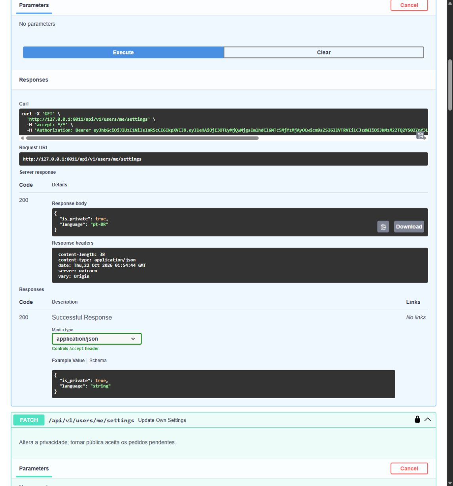
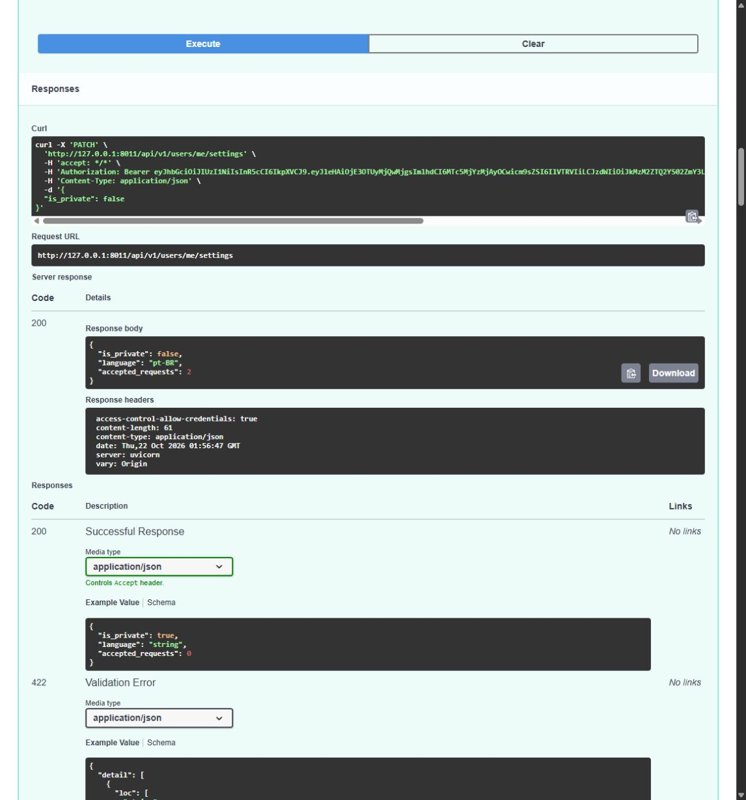
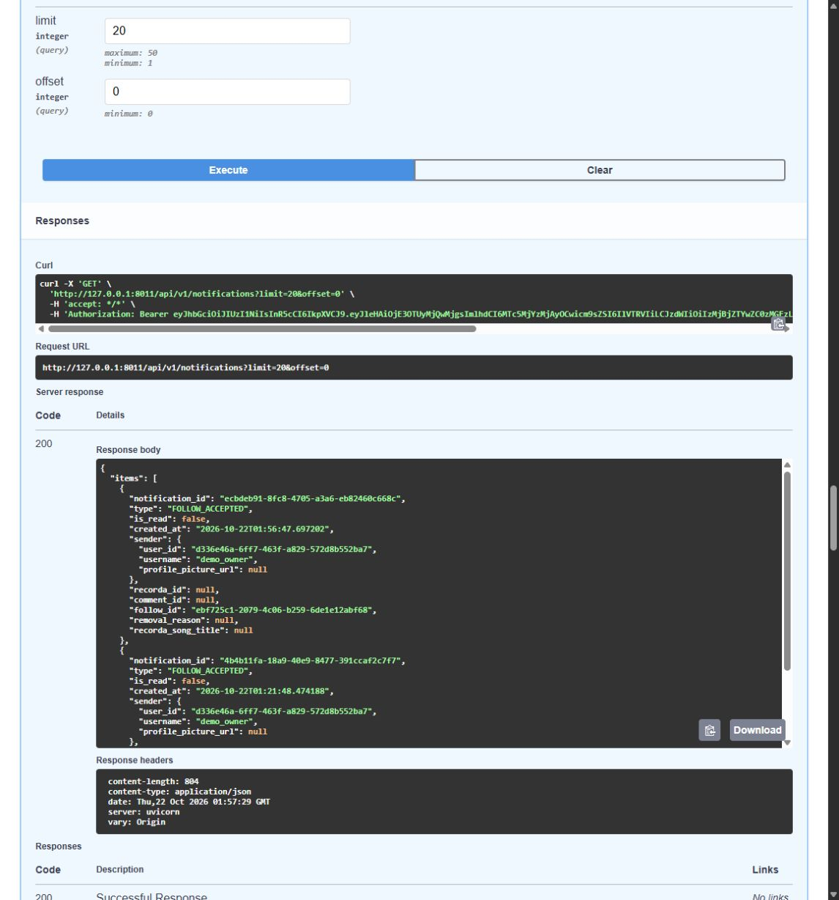
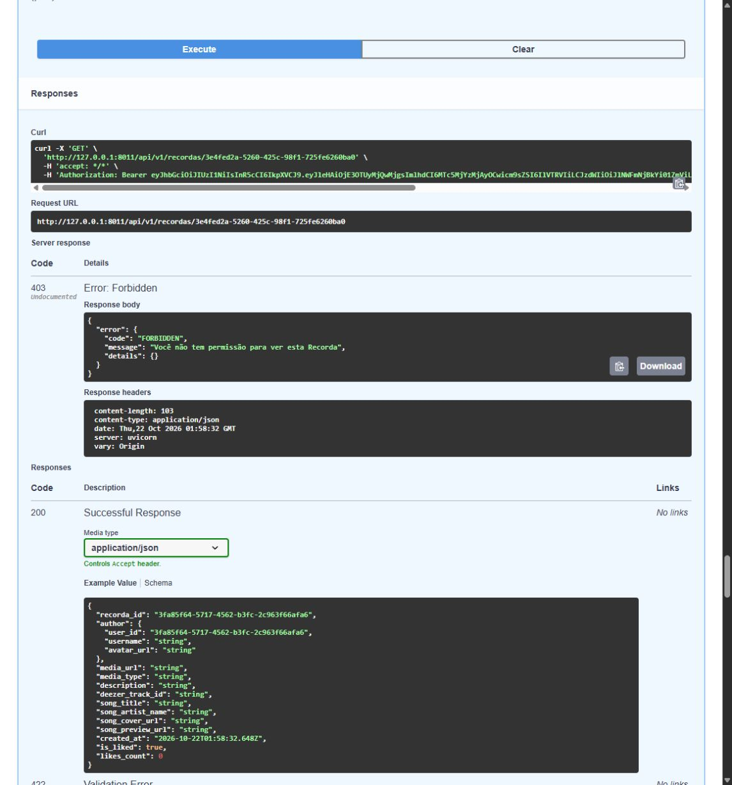
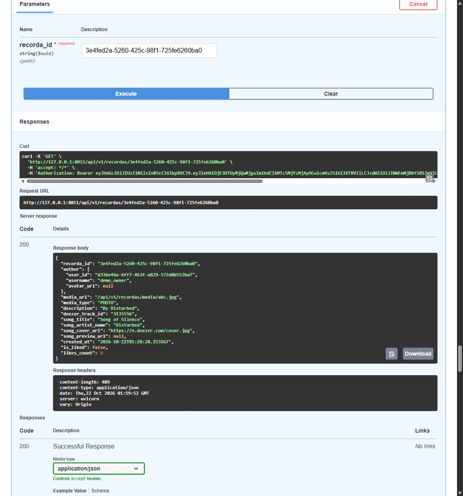

# Validação acompanhada — issue #111

Em 21/10/2026 (America/Sao_Paulo), o Codex executou os três cenários no Swagger visível a pedido do usuário. O usuário acompanhou a demonstração e autorizou incluir seus resultados no PR. As operações usaram a API real, com banco SQLite descartável e contas de exemplo. Não foi uma execução independente pelo usuário.

| Cenário | Resultado observado |
| --- | --- |
| 1. Persistência de privacidade | PATCH pública e privada retornaram 200. O GET confirmou cada valor salvo e `language: "pt-BR"` permaneceu inalterado. |
| 2. Aceite automático e notificações | Dois POSTs retornaram `solicitado`. O PATCH público retornou `accepted_requests: 2`; as duas `FOLLOW_REQUEST` viraram `NEW_FOLLOWER` mantendo seus `follow_id`; cada solicitante recebeu uma única `FOLLOW_ACCEPTED` para o novo pedido. Repetir PATCH público retornou 0. |
| 3. Privacidade retroativa e seguidor preservado | Na mesma Recorda existente, o visitante recebeu 200 em conta pública, 403 em privada e 200 após reabertura. Grid e lista de seguidores acompanharam a mesma sequência. O seguidor aceito manteve 200 nos três endpoints com conta privada. |

## Capturas

### 1. GET confirma privacidade salva

### 2. Dois pedidos aceitos e aviso ao solicitante

### 3. Visitante bloqueado, seguidor preservado e visitante liberado

[Respostas completas observadas no Swagger](guided-demo-output.txt) · [Roteiro para reprodução](manual-tests.md).

Limites: esta demonstração no Swagger não testa bloqueios do PostgreSQL ou o feed por afinidade musical. O feed e o rollback foram cobertos na suíte automatizada. Em 22/10, os sete testes específicos de PostgreSQL, incluindo concorrência, passaram em banco descartável; consulte a [validação complementar](postgres-validation.md).
