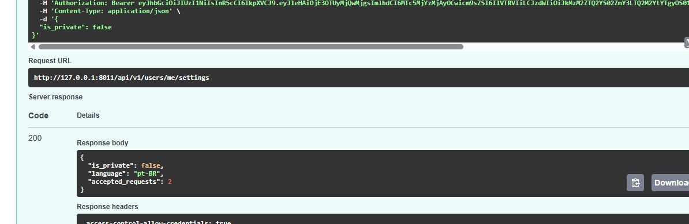
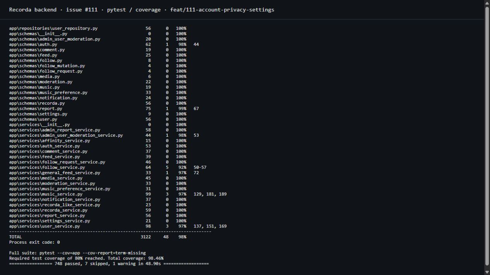

# T-E6.US32.BE.01 — Configurações da conta e privacidade

Implementa a [issue #111](https://github.com/Recorda-ages/recorda-backend/issues/111).

## API

Todas as rotas exigem um Bearer token válido de uma conta ativa.

- `GET /api/v1/users/me/settings`: retorna `is_private` e o `language` salvo no banco.
- `PATCH /api/v1/users/me/settings`: recebe `{"is_private": true}` ou `false` e retorna as configurações com `accepted_requests`.
- `GET /api/v1/users/{user_id}/recordas`: retorna as Recordas não excluídas do perfil, da mais recente para a mais antiga; responde 403 para visitantes sem acesso a conta privada e 404 para perfil inexistente, suspenso ou excluído.

Tornar a conta privada preserva seguidores aceitos. Novos follows passam a pedidos pendentes. Torná-la pública aceita os pedidos recebidos pendentes, preenche `accepted_at` em UTC, converte `FOLLOW_REQUEST` em `NEW_FOLLOWER` e cria `FOLLOW_ACCEPTED` para cada solicitante. Privacidade, aceites e notificações são persistidos na mesma transação; qualquer falha desfaz a operação inteira.

O aceite individual e o automático compartilham `_accept`, sem commit interno. O POST de follow e o PATCH de privacidade coordenam o bloqueio da mesma conta no PostgreSQL e recarregam o estado antes da decisão. Isso impede um pedido novo de ficar pendente após a conta se tornar pública.

Enviar o valor atual, `{}` ou `{"is_private": null}` retorna 200 sem alterar a conta e com `accepted_requests: 0`. O endpoint não altera idioma; essa escrita pertence à US33. Não há migration ou dependência nova.

## Validação

Executado em Python 3.13.16:

```powershell
.venv/Scripts/python.exe -m pytest --cov=app --cov-report=term-missing
.venv/Scripts/python.exe -m ruff check .
.venv/Scripts/python.exe -m ruff format --check .
```

- 748 testes passaram; cobertura global 98,46%.
- 24 testes da tarefa executados com autenticação e SQLAlchemy reais em SQLite, incluindo isolamento dos pedidos, notificações, rollback, no-op, contas inativas, leitura desatualizada e privacidade retroativa em conteúdo existente.
- Schemas de configurações, serviço de configurações e serviço de aceite: 100% de cobertura de linhas na suíte completa.
- Ruff: nenhum erro de lint ou formatação.
- 7 testes que exigem PostgreSQL foram ignorados por ausência de `TEST_DATABASE_URL`, incluindo o novo teste de concorrência com duas sessões e bloqueio real. O Docker instalado estava sem daemon ativo. A concorrência no PostgreSQL permanece sem execução local.
- Há um aviso existente de depreciação de `httpx` no TestClient do Starlette.

## Evidências reais





- [Respostas HTTP e resultado do Swagger](evidence/111/api-output.txt)
- [Saída completa do pytest](evidence/111/test-output.txt)
- [Saída do terminal de cobertura](evidence/111/coverage-terminal-output.txt)
- [Entrada da prévia isolada](evidence/111/preview-entry.py.txt)
- [Três cenários executados no Swagger com o usuário acompanhando](evidence/111/guided-demo.md)

As capturas usam a API real via Uvicorn e um SQLite temporário autorizado, com `demo_owner` e dois solicitantes de exemplo. Não há mocks nos endpoints, nem alteração de configuração de produção. O banco da prévia usa `Base.metadata.create_all`, como a fixture SQLite dos testes; não demonstra migrations ou bloqueios do PostgreSQL. URLs de mídia dos fixtures não foram acessadas nem são necessárias para estes endpoints.

A captura Swagger mostra o PATCH `is_private: false` retornando 200 e `accepted_requests: 2`. Chamadas HTTP posteriores confirmam as duas notificações `FOLLOW_ACCEPTED`, as duas `NEW_FOLLOWER`, o no-op público e a preservação do acesso desses seguidores após voltar a conta para privada.

Para reproduzir a prévia, copie `preview-entry.py.txt` para `../tmp/preview-backend-111.py` e execute a partir do repositório com `.venv/Scripts/python.exe ../tmp/preview-backend-111.py`; abra `http://127.0.0.1:8011/docs`. A entrada gera uma sessão de exemplo em `../tmp/preview-111-session.json`, fora do repositório. Crie os pedidos pelo POST de follow antes de executar o PATCH no Swagger. A chave da prévia é exclusiva e descartável; nenhuma credencial real aparece nas evidências.
